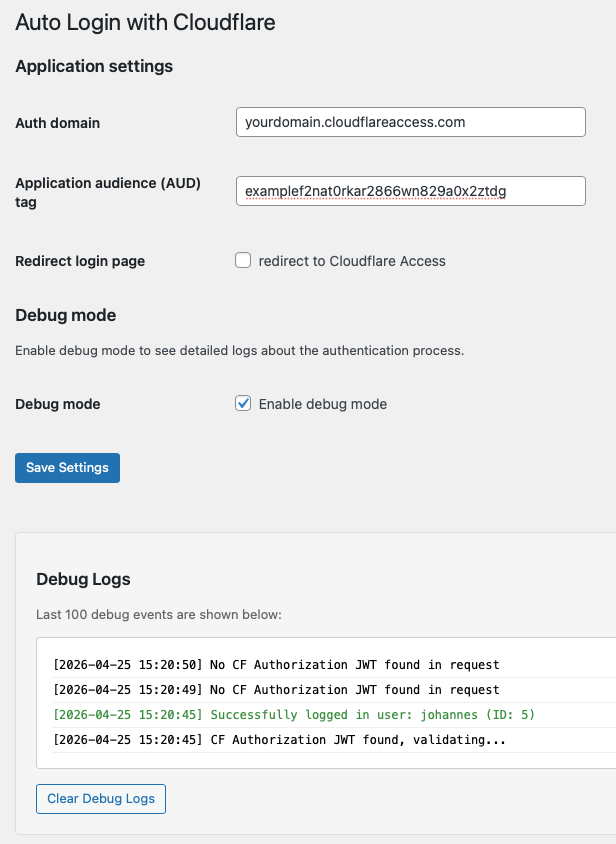

# Auto Login for Cloudflare Access

WordPress plugin: users who signed in through [Cloudflare Access](https://developers.cloudflare.com/cloudflare-one/applications/configure-apps/self-hosted-apps/) are logged in to WordPress automatically, matched by email address.

Actively maintained fork of [Auto Login with Cloudflare](https://github.com/kanru/auto-login-with-cloudflare) by Kan-Ru Chen, which is no longer available. Settings of that plugin are migrated on activation.

Not affiliated with or endorsed by Cloudflare, Inc.



## Features

- Verifies the Cloudflare Access JWT: RS256 signature against your team's published keys, expiry, audience and issuer
- Handles Cloudflare's signing key rotation
- Optional redirect of `wp-login.php` to Cloudflare Access, and Access logout on WordPress logout
- Debug log on the settings page
- Configuration via the settings page or `wp-config.php`:

```php
define('WP_CF_ACCESS_AUTH_DOMAIN', 'yourteam.cloudflareaccess.com');
define('WP_CF_ACCESS_JWT_AUD', 'your-aud-tag');
define('WP_CF_ACCESS_REDIRECT_LOGIN', true);
define('WP_CF_ACCESS_DEBUG_MODE', false);
```

## Installation

Download the latest `.zip` from [Releases](https://github.com/johanneswk/auto-login-for-cloudflare-access/releases) and upload it under **Plugins → Add New → Upload Plugin**. Then configure it under **Settings → Auto Login for Cloudflare Access**.

See [`readme.txt`](readme.txt) for full documentation, FAQ and changelog (it is also the WordPress.org listing).

## Development

Requires PHP 8.0+ and Composer. Dependencies are not committed; `composer.lock` pins them.

```sh
composer install
```

Every push builds the installable zip (with `vendor/`) via GitHub Actions and publishes it as a pre-release for the current `Version:`. To make that version stable, run the **Build plugin zip** workflow manually (Actions → Run workflow) with **stable** ticked. A stable release is never overwritten; bump the version for the next build.

## License

GPL-2.0-or-later. Copyright (C) 2021 Kan-Ru Chen, (C) 2025-2026 Johannes Kistemaker.
